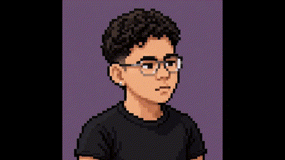

 

# ROGERDEV

**Desenvolvedor em formação · WorldSkills 2026**

Construindo soluções, explorando tecnologias e transformando ideias em código.

---

  

### TECH STACK

---

### ABOUT ME

Sou estudante de **Técnico em Desenvolvimento de Sistemas**, apaixonado por tecnologia, desenvolvimento web e criação de soluções digitais.

Atualmente, foco meus estudos no desenvolvimento Full Stack, explorando tecnologias modernas e construindo projetos próprios.

- 💻 Desenvolvimento Web
- ⚙️ JavaScript, React e Node.js
- 🚀 Construção de aplicações e sistemas
- 📚 Aprendizado contínuo e resolução de problemas

### ACHIEVEMENTS

**WORLDSKILLS 2026**

🏆 Campeão da Etapa Local — SENAI

Representando minha instituição e buscando evoluir cada vez mais na área de tecnologia.

---

*Building ideas into reality.*

